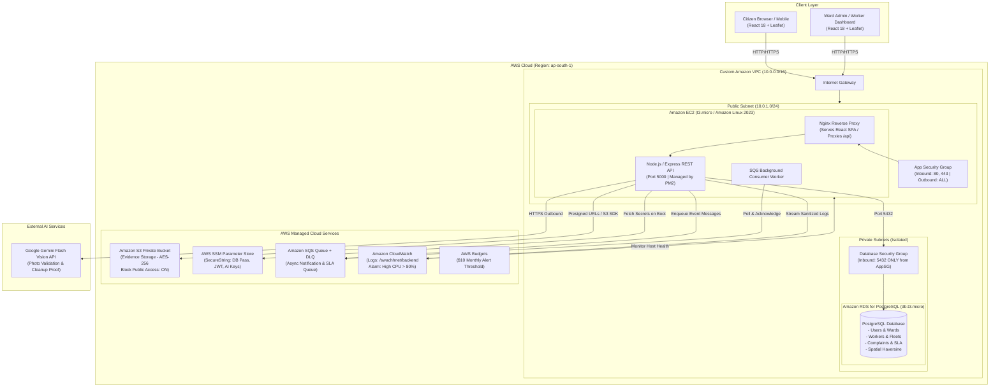

# SwachhNet Cloud Architecture Specification

## 1. Executive Summary
**SwachhNet** is an enterprise-grade municipal solid waste reporting and dispatch system designed around the administrative hierarchy of the **Brihanmumbai Municipal Corporation (BMC)**. 

To meet the requirements of the Cloud Computing Lab (CCL) mini-project, the system has been migrated from a traditional local/NoSQL setup into a resilient, secure, and cost-effective cloud architecture on **Amazon Web Services (AWS)**.

---

## 2. Architecture Diagram

---

## 3. Network & Security Architecture

### 3.1 Custom VPC Design
* **CIDR Block:** `10.0.0.0/16` (65,536 private IP addresses).
* **Public Subnet (`10.0.1.0/24`):**
  * Located in Availability Zone A (`ap-south-1a`).
  * Attached to the Internet Gateway via a public route table (`0.0.0.0/0 -> IGW`).
  * Hosts the Amazon EC2 instance with public IPv4 for direct web access.
* **Private Subnet 1 (`10.0.10.0/24`) & Private Subnet 2 (`10.0.11.0/24`):**
  * Spans across Availability Zones A and B (`ap-south-1a`, `ap-south-1b`).
  * Required by Amazon RDS DB Subnet Groups for multi-AZ compatibility.
  * Completely isolated from the Internet Gateway (no public IP allocation, no default route to IGW).

### 3.2 Security Group Layering (Defense-in-Depth)
1. **Application Security Group (`AppSecurityGroup`):**
   * **Inbound:**
     * Port `80` (HTTP) & Port `443` (HTTPS) from `0.0.0.0/0`.
   * **Outbound:**
     * All traffic (`-1`) to `0.0.0.0/0` (required for calling Google Gemini API, SSM, S3, SQS, and OS packages).
2. **Database Security Group (`DatabaseSecurityGroup`):**
   * **Inbound:**
     * Port `5432` (PostgreSQL) strictly from `AppSecurityGroup` by security group reference.
     * **CRITICAL:** `0.0.0.0/0` is strictly forbidden. The database cannot be reached from the outside world.
   * **Outbound:**
     * Responses back to `AppSecurityGroup`.

---

## 4. Compute & Process Architecture

### 4.1 Hybrid EC2 Deployment (Why not 100% Serverless?)
In cloud computing design, monolithic single-page applications with WebSocket or long-running worker loops, local reverse proxies, and predictable low-cost usage benefit substantially from an EC2 instance:
* **Cost Predictability:** A small `t3.micro` instance incurs a flat, predictable cost (covered under AWS Free Tier) compared to per-request API Gateway and Lambda concurrency limits.
* **Nginx Reverse Proxy:** Nginx serves the pre-compiled React 18 production bundle directly from memory/disk while proxying `/api/*` to the Express backend running on `localhost:5000`.
* **Zero Cold Starts:** Unlike AWS Lambda, the backend process remains hot in memory via PM2, delivering sub-20ms response times for municipal dispatch queries.
* **Integrated Worker:** The SQS background consumer worker runs concurrently on the same host, eliminating the need for extra compute clusters.

---

## 5. Storage & Evidence Access Paths

### 5.1 Private S3 Bucket with Presigned URLs
Citizen garbage photos and worker cleanup proofs represent private municipal evidence:
* **Bucket Policy:** Public Access is completely blocked (`BlockPublicAcls: true`, `IgnorePublicAcls: true`, `BlockPublicPolicy: true`, `RestrictPublicBuckets: true`).
* **Encryption:** Server-Side Encryption with Amazon S3 managed keys (`AES256`).
* **Upload Path:**
  1. The client browser submits the photo file buffer via multipart form data to `/api/complaints`.
  2. The backend validates file format and runs Gemini AI garbage validation.
  3. The backend streams the buffer to S3 using the IAM role's `PutObjectCommand`.
  4. The generated S3 object key (`complaints/<uuid>.jpg`) is persisted in PostgreSQL.
* **Download Path:**
  1. When fetching complaints (`/api/complaints/user` or `/api/complaints/all`), the backend calls `getPresignedDownloadUrl()`.
  2. S3 generates a cryptographic, short-lived signed URL (valid for 1 hour).
  3. The frontend renders the image via this temporary URL. Permanent public links are never stored or exposed.

---

## 6. Asynchronous Processing with Amazon SQS
To decouple heavy operations from customer-facing API latency:
* **Producer:** When a complaint is created, dispatched, or resolved, the Express controller calls `enqueueJob(jobType, payload)`.
* **Queue:** Amazon SQS standard queue (`swachhnet-jobs-queue`) with a 60-second visibility timeout.
* **Consumer:** A continuous background worker polls the queue via long polling (`WaitTimeSeconds: 15`), executes audit logging and simulated SMS/email dispatch, and acknowledges completion via `DeleteMessageCommand`.
* **Dead-Letter Queue (DLQ):** Messages failing 5 consecutive processing attempts are routed to `swachhnet-jobs-dlq` for administrator inspection.

